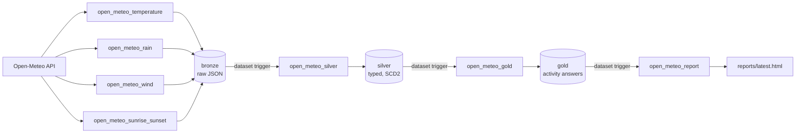

# Open-Meteo Medallion ETL

An end-to-end, locally runnable data pipeline that ingests weather forecasts from the
[Open-Meteo Forecast API](https://open-meteo.com/en/docs), refines them through a
**bronze → silver → gold** medallion architecture in PostgreSQL, and answers everyday
questions such as *"Can I swim today in Melbourne?"* or *"When can I walk my dog?"* —
both as SQL views and as an HTML report.

Orchestrated with **Apache Airflow 2.10**, everything runs in **Docker Compose**.
A walkthrough deck is in [`docs/presentation.html`](docs/presentation.html) (open it in a browser; arrow keys to navigate).



## Quick start

**Prerequisites:** Docker with Docker Compose. Give Docker **at least 4 GB of memory**
(Docker Desktop → Settings → Resources); Airflow is unstable on 2 GB.

```bash
git clone https://github.com/RashbirSingh/open-meteo-Medallion-Architectur-ETL.git
cd open-meteo-Medallion-Architectur-ETL

cp .env.example .env
# Edit .env: set passwords and a Fernet key, e.g.
python3 -c "import base64, os; print(base64.urlsafe_b64encode(os.urandom(32)).decode())"
# Linux only: set AIRFLOW_UID to the output of `id -u`

docker compose up -d          # or: docker-compose up -d
```

After ~1–2 minutes:

| What | Where |
|---|---|
| Airflow UI | http://localhost:8080 (user/password from `.env`) |
| PostgreSQL | `localhost:5432`, database `loopiq` (credentials from `.env`) |
| HTML report | `reports/latest.html` (open in a browser) |

DAGs are unpaused on creation, so the four ingestion DAGs start on their schedules and
everything downstream follows automatically. To populate immediately, trigger the four
`open_meteo_*` ingestion DAGs from the Airflow UI (or
`docker exec loopiq-airflow airflow dags trigger open_meteo_temperature`, etc.).

Stop with `docker compose down` (data is kept in the `loopiq-pgdata` volume);
`docker compose down -v` also deletes the data.

## What happens on start-up

- **Postgres** creates the `loopiq` (warehouse) and `airflow` (metadata) databases and the
  `bronze`, `silver`, `gold` schemas on first boot (`postgres/init/01-init.sh`).
- **Airflow** (`scripts/start-airflow.sh`) migrates its metadata DB, creates the admin user,
  and stores the `loopiq_postgres` connection in **Airflow Connections** (encrypted with the
  Fernet key). Every DAG uses that connection id; no credentials live in DAG code.

## Pipelines

| DAG | Schedule | Does |
|---|---|---|
| `open_meteo_temperature` | hourly | API → `bronze.temperature_raw` |
| `open_meteo_rain` | hourly | API → `bronze.rain_raw` |
| `open_meteo_wind` | hourly | API → `bronze.wind_raw` |
| `open_meteo_sunrise_sunset` | daily | API → `bronze.sunrise_sunset_raw` |
| `open_meteo_silver` | when any bronze table updates | bronze → 7 silver tables |
| `open_meteo_gold` | when silver updates | silver → gold activity tables |
| `open_meteo_report` | when gold updates | gold → `reports/latest.html` |

Downstream DAGs are chained with Airflow **Datasets**, so each layer runs as soon as its
inputs land. Locations: London, New York, Tokyo, Melbourne, Sydney, Brisbane (Queensland),
7-day forecasts. Edit `LOCATIONS` in `airflow/dags/common/open_meteo.py` to change them.

## Medallion layers

### Bronze: raw, immutable history
One table per pipeline. Each run stores the **untouched API JSON** per location
(`payload JSONB`) plus the request sent, HTTP status, extraction time and a hash of the
forecast content.

### Silver: cleaned and typed
| Table | Grain | Measures |
|---|---|---|
| `temperature_hourly` | location × hour | `temperature_c`, `apparent_temperature_c`, `dew_point_c` |
| `temperature_daily` | location × day | `temperature_max_c`, `temperature_min_c` |
| `rain_hourly` | location × hour | `precipitation_mm`, `rain_mm`, `showers_mm`, `precipitation_probability_pct` |
| `rain_daily` | location × day | sums, `precipitation_hours`, max probability |
| `wind_hourly` | location × hour | `wind_speed_kmh`, `wind_direction_deg`, `wind_gusts_kmh` |
| `wind_daily` | location × day | max speed, max gusts, dominant direction |
| `sunrise_sunset_daily` | location × day | `sunrise_local`, `sunset_local`, daylight & sunshine duration |
| `etl_load_log` | bronze row | rows inserted / closed / unchanged per load (incremental watermark) |

Hourly tables carry local and UTC time, derived from the IANA time zone (DST-correct).
The load is incremental (only unprocessed bronze rows), one transaction per bronze row,
and **fails if the API returns unexpected units**.

### Gold: answers
| Object | What it answers |
|---|---|
| `gold.activity_hourly` | every hour × location × activity (swim, run, dog_walk, walk): suitable?, score 0–100, reasons (too cold, rain likely, too windy, dark, …) |
| `gold.activity_daily` | per day: can I?, all suitable windows, best window, best hour, main blocker |
| `gold.activity_today` (view) | rest of today in each city's local time, computed at query time |
| `gold.can_i_swim_today` | *Can I swim today?* |
| `gold.can_i_go_for_a_run_today` | *Can I go for a run?* |
| `gold.can_i_walk_my_dog_today` | *Can I walk my dog?* |
| `gold.best_time_to_swim_today` | *What is the best time to swim today?* |
| `gold.when_can_i_walk_today` | *When can I walk today?* |

```sql
SELECT answer FROM gold.can_i_swim_today WHERE location_name = 'Melbourne';
-- Yes - 12:00-15:00, 18:00-19:00; best around 13:00 (feels 26°C, 0% rain chance, wind 4 km/h)

SELECT * FROM gold.when_can_i_walk_today WHERE location_name = 'Melbourne';
```

Activity thresholds (feels-like temperature, rain chance and amount, wind, gusts, daylight)
are in `ACTIVITIES` in `airflow/dags/common/gold.py`.

## Auditing and history

Every table (bronze, silver, gold, load log) has:

- **SCD Type 2 versioning:** `row_start_date`, `row_end_date` (`9999-12-31` while open),
  `is_current`; a partial unique index allows only one live current row per business key.
- **Audit:** `created_at`, `created_by`, `row_updated_at` (maintained by trigger), `updated_by`.
- **Soft delete:** `is_deleted`, `deleted_at`, `deleted_by`, `delete_reason`; rows are never
  hard-deleted (re-running a bronze run soft-deletes the rows it replaces).
- **Lineage:** `dag_id`, `dag_run_id`, `task_id`, `record_hash`, and links to the source
  row (`source_bronze_id`, `source_*_id`).

A new version is written only when a record's content hash changes, so unchanged
forecasts do not create noise.

## Project layout

```
airflow/dags/
  open_meteo_{temperature,rain,wind,sunrise_sunset}.py   bronze ingestion DAGs
  open_meteo_silver.py / open_meteo_gold.py / open_meteo_report.py
  common/open_meteo.py      API client, locations, bronze DDL + load
  common/silver.py          silver table specs, SCD2 merge, load log
  common/gold.py            activity rules, gold tables and views
  common/report.py          report builder; report_template.html is the page
docker-compose.yml          Postgres 16 + Airflow 2.10.5 (standalone)
scripts/start-airflow.sh    Airflow bootstrap (migrate, admin user, connection)
postgres/init/01-init.sh    databases and schemas on first boot
reports/                    generated HTML reports (git-ignored)
```

## Troubleshooting

- **Tasks fail with empty logs / `SIGKILL` / API timeouts:** Docker is out of memory. Raise
  Docker's memory to 4 GB or more.
- **A DAG file doesn't appear:** Airflow only parses files that contain the words "airflow"
  and "dag"; keep the module docstrings.
- **Changed the Postgres password in `.env`:** the stored Airflow connection is not updated
  automatically. Edit `loopiq_postgres` under Admin → Connections, or delete it and restart.
- **Swimming** uses air "feels like" temperature only; the forecast API has no water
  temperature or UV index.
